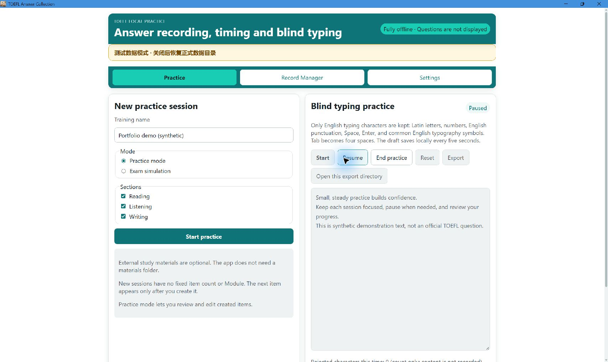

# TOEFL Answer Collection

[English](README.md) | [简体中文](README.zh-CN.md) | [日本語](README.ja.md) | [繁體中文](README.zh-TW.md)

TOEFL Answer Collection 是**本機優先的 Windows 答案記錄與英文盲打工具**，用來記錄 TOEFL 練習答案、計時與複習。學習資料在應用程式外自行參閱；**程式不包含官方題目、音訊或標準答案**。

*實際 v1.0.1 Windows 應用程式，使用獨立測試資料與合成文字擷取，畫面為英文 UI。測試提示刻意保留；不含個人記錄或官方教材。[擷取條件](docs/product/SCREENSHOTS.md)。*

## 快速開始

1. 從 [Release 下載 v1.0.1 Windows 安裝程式](https://github.com/HanamiGekka/TOEFL-Answer-Collection/releases/tag/v1.0.1)，以目前的 Windows 帳戶安裝，再從開始功能表啟動。
2. 在練習頁輸入**練習名稱**，選擇 Reading／Listening／Writing，再開始練習。接著逐題或批次建題，不必指定教材資料夾。
3. 英文盲打可直接在同頁的盲打練習區開始，並可暫停或結束；草稿與匯出檔儲存在本機。
4. 在 Record Manager 檢視已儲存記錄，在設定的 **Data folder（資料資料夾）**中查看或選擇儲存位置。

**執行需求：**Windows 10/11 x64 與 Microsoft Edge **WebView2**；未安裝 WebView2 時，安裝程式可能協助導入。安裝程式**未簽署**，可能出現 SmartScreen 警告。執行正式應用程式不需要 Node.js、Rust 等開發工具。

## 目前功能

- Reading、Listening、Writing 以**動態 schema v6** 記錄答案，可建立單選、多選、短文字、長文字題目，設定自訂標籤與選用時限。
- 支援 **1–100 題**批次建立、內建批次與各部分含多個區塊的可重用範本；範本儲存在目前儲存資料夾的本機設定中。
- 支援計時、暫停與繼續、狀態標記、題目導覽、重新開啟部分、結果摘要、復原未完成工作階段與多格式匯出。
- 獨立英文盲打提供草稿、統計與匯出；Record Manager 與垃圾桶管理本機記錄。
- 介面支援英文、簡體中文、日文與繁體中文。首次預設英文，後續保留已儲存的語言選擇。

## 資料安全

**儲存資料夾**預設位於目前帳戶的應用程式資料目錄。記錄、Recovery、SQLite、日誌與匯出儲存在這裡，應用程式設定另存於帳戶的設定目錄。**變更儲存資料夾不會自動移轉舊記錄**；需要查看舊記錄時，請重新選擇原資料夾。

應用程式沒有網路功能或遙測。正式記錄透過 Record Manager 刪除，分享匯出檔前請檢查內容。公開原始碼不含個人答案、真實練習記錄、Recovery、資料庫、本機設定、外部教材或私有開發歷史。詳見[隱私及安全](docs/product/PRIVACY_AND_SAFETY.md)。

## 本機開發

以 Tauri、TypeScript 與 Rust 建置。 從原始碼建置使用 **Node.js 24.18.0**（接受相容的 24.x）與 **Rust 1.96.1**，並需準備 Windows Tauri 元件。[開發與建置指南](docs/development/BUILD.md)集中說明安裝、稽核、測試與封裝指令；執行結構見[架構](docs/product/ARCHITECTURE.md)。儲存庫 CI 檢查 Ubuntu 前端與 Windows 原生／封裝行為。

## 記錄相容性

正式 **v1.0.0 動態 v6 記錄仍可讀取**；不支援 v6 之前的記錄，目前程式不提供 Speaking。

## 授權與獨立性

專案原創原始碼及文件採用 [MIT 授權](LICENSE)，相依套件保留各自條款。本專案是獨立學習工具，**與 ETS 無關，也未獲其認可**；不散布官方 TOEFL 題目、音訊或答案。

## 文件

[路線圖](docs/development/ROADMAP.md) · [變更記錄](docs/development/CHANGELOG.md) · [資料模型](docs/product/DATA_SCHEMA.md) · [匯出格式](docs/product/EXPORT_FORMAT.md) · [隱私及安全](docs/product/PRIVACY_AND_SAFETY.md)
